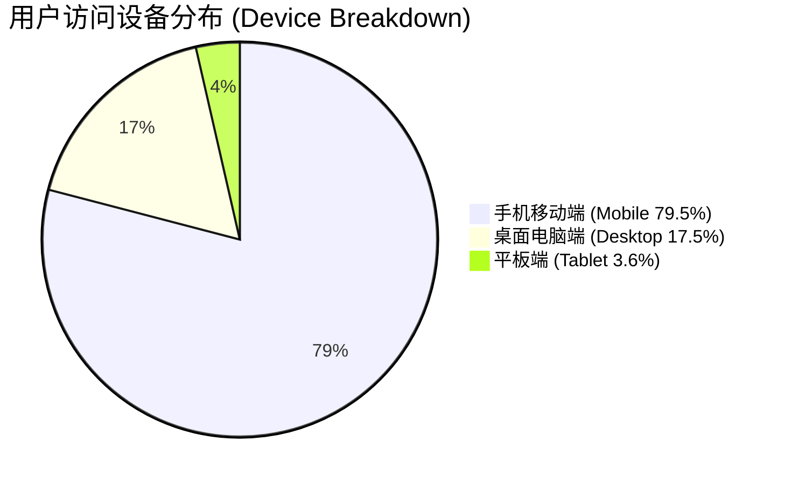
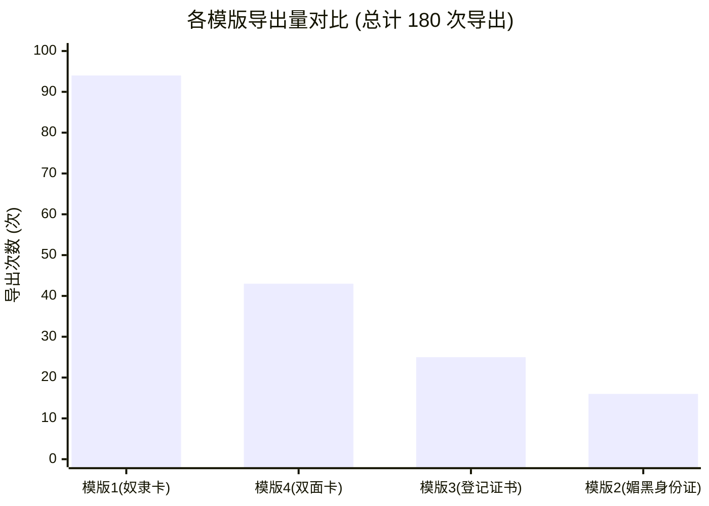
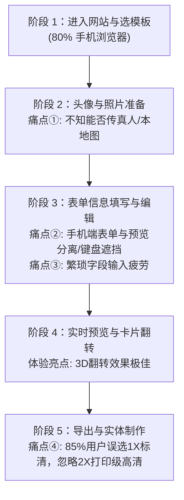

# Google Analytics (GA4) 访问数据与用户使用路径深度分析报告

**数据周期**：2026年10月11日 - 2026年11月7日（近28天）  
**分析对象**：`Slut-ID-Generator`（小骚货身份证明生成器）  
**数据源**：Google Analytics 4（Property ID: 561710252 / 媒体资源 ID: G-R1WG5XHNR8）及生如夏花论坛发布帖（`bbs.viva-la-vita.org/d/83903`）用户反馈与跟帖。

---

## 一、 数据全貌与用户画像 (Demographics & Traffic)

### 1.1 总体流量与参与指标

| 指标项 | 统计数值 | 行业参考 / 评估 |
| :--- | :--- | :--- |
| **活跃用户数 (Active Users)** | **361 人** | 新增用户 352 人（占比 97.5%），呈现典型的初期病毒传播模式 |
| **访问会话总数 (Sessions)** | **439 次** | 人均会话 1.22 次，已有部分种子用户收藏并二次回访 |
| **总事件量 (Event Count)** | **5,909 次** | 平均每会话触发 13.5 次互动事件，交互活跃度极高 |
| **平均参与时长 (Avg Engagement)**| **2 分 00 秒** | 工具类网页极高水平，说明用户深入探索了表单编辑与卡片预览 |
| **跳出率 (Bounce Rate)** | **12.1%** | 极低（模版锚点跳出率仅 2.6%~3.8%），说明目标受众匹配度精准 |

> [!IMPORTANT]
> **绝对的移动端主导**：**接近 80% 的用户通过手机访问**。移动端的单手操作体验、软键盘遮挡、图片上传缩放便捷性，直接决定了整个产品的核心留存与转化效率。

---

### 1.2 流量来源渠道与传播路径

1. **直接访问 (Direct / None)**：227 Sessions / 191 Users  
   - 用户复制论坛链接到外部独立浏览器（如 Safari、Chrome Mobile）打开；
   - 微信 / Telegram 等私密社群内部点对点直接转发链接。
2. **夏花论坛来源 (viva-la-vita / forum via UTM)**：195 Sessions / 165 Users  
   - 论坛主帖是核心用户孵化基地，回帖与求更新意愿强烈。
3. **其他次级引流**：Telegram Web (`web.telegram.org`)、推特/社群外部转发。

### 1.3 地域分布

- **中国大陆**：占比最高（超 60% 用户来自华南、华东与一线城市：广州 35人、上海 22人、深圳 19人、北京 18人、成都 12人、武汉 9人）。
- **港澳台及海外**：香港（19人）、美国（14人）、日本（12人）、新加坡（4人）、台湾（4人）。（多为通过 VPN 访问或海外华人小众群体）。

---

## 二、 用户偏好功能与模版深度解析 (Feature Preferences)

### 2.1 各模版访问量 (PV) 与导出量 (Export) 表现

根据 GA4 自定义探索报表《各页面与按钮导出统计》及页面维度数据交叉比对：

| 模版代号 | 模版名称 | 浏览量 (PV) | 访问用户数 | 导出总次数 | 导出占比 | 转化率 (导出/独立访客) |
| :--- | :--- | :---: | :---: | :---: | :---: | :---: |
| **模版 1** | **奴隶身份卡** | **564** | **292** | **94 次** | **52.2%** | **32.2%** 🏆 |
| **模版 4** | **极清双面卡** | **340** (正/背/全) | **103** | **43 次** | **23.9%** | **41.7%** 🥈 |
| **模版 3** | **终身登记证书** | **208** | **99** | **25 次** | **13.9%** | **25.3%** 🥉 |
| **模版 2** | **媚黑身份证** | **201** | **108** | **16 次** | **8.9%** | **14.8%** |
| **模版 5** | **纪念明信片** | *（v2.0 新上线，暂无全量月度数据）* | - | - | - | - |

#### 模版偏好归因：
1. **模版 1（奴隶身份卡）绝对统治地位（52.2% 导出）**：
   - **认知负荷最低**：经典单面卡版式，布局结构直观，文字量适中，用户打开后无需翻面即可即时预览所见即所得。
   - **受众通用性强**：调教/女奴契约是最广泛通用的题材，门槛低、代入感强。
2. **模版 4（极清双面卡）展现出极强的互动粘性与最高转化率（41.7%）**：
   - 尽管是多面编辑，但访问该模版的用户有 **41.7%** 最终完成了导出，且衍生出多种导出形态（正面18次、背面12次、双面打包9次、长图拼图4次）。
   - **`bimbo_side_switch`（3D 翻转卡片）事件触发了 154 次**（39位用户人均翻转达 4 次），说明 3D 拟真卡片动效带来了极其出色的趣味性与沉浸感。
3. **模版 2（媚黑身份证）转化率偏低（仅 8.9%）**：
   - 属性标签多达 18 项勾选矩阵，在移动端小屏上密密麻麻，容易引起输入疲劳；题材相对垂直，泛化受众不如通用奴隶卡。

---

### 2.2 随机人设灵感库（Random Inspiration）使用排行

随机人设按钮总点击达 **212 次**，人均在创建过程中点击 1.8 次。各人设欢迎程度排名：

> [!TIP]
> **用户心理洞察**：
> 1. **“温顺猫奴”与“反差人妻”断层领跑**，反映出用户群体对日常身份反差、极度温顺臣服人设的极高偏爱。
> 2. **预设人设是核心灵感支柱**：大量移动端用户不愿在手机软键盘上打几百字的“印刻条款”或“誓约词”，他们更倾向于“**基于现成人设微调**”（如论坛用户所言：“一部分按作者原版，一部分自己改一下”）。

---

## 三、 用户使用路径与全链路痛点诊断 (User Journey & Pain Points)

通过梳理 GA4 转化漏斗（访客 361 → 模版深度交互 292 → 导出 78），综合论坛真实玩家跟帖反馈，诊断出以下 **四大核心痛点**：

### 痛点 ①：自定义照片上传感知度不足，缺乏真人/自拍引导
- **现象**：夏花论坛跟帖中多位新用户直接询问：*“能做真人的吗？”*
- **根因分析**：
  - 目前界面按钮是“选择预设头像”，用户第一印象以为这只是个“二次元动漫插画生成器”，不知道系统支持任意本地照片上传、居中裁剪、微调缩放。
  - 缺乏针对自拍、真人证件照、私房照的明确提示与隐私安全告知（本地纯前端 Canvas 处理，不上传任何服务器）。

### 痛点 ②：移动端体验与软键盘冲突（80% 移动端流量下的最大瓶颈）
- **现象**：移动端平均停留时间（1m 48s）低于桌面端（2m 31s），模版 2 填写中途放弃率高。
- **根因分析**：
  - 在手机竖屏下，表单与卡片预览需要通过顶部 Tab 切换（“编辑信息 / 预览效果”），用户在输入长文本时无法直观感知卡片排版是否溢出。
  - 虚拟键盘弹起时，底部的控制条、随机生成按钮被顶起或遮挡，偶有布局抖动。

### 痛点 ③：导出分辨率盲区（85% 用户只导出了 1X 标清）
- **现象**：
  - 模版 1 导出中，1X 标清达 85 次，2X 超清仅 9 次；模版 2 中 1X 达 14 次，2X 仅 2 次。
  - 论坛玩家跟帖：*“打印出来，更好”*，但大部分用户导出时并没有去点下拉菜单切换 2X。
- **根因分析**：
  - 导出按钮默认行为是 1X（针对屏幕浏览），而 2X 超清（300 DPI 印刷级）藏在下拉列表或次级选择里。用户直接点击主按钮下载后，打印时可能会发现文字发虚。

### 痛点 ④：多面卡片（模版 4）在移动端编辑时的正反面切换割裂
- **现象**：模版 4 的 3D 翻转动效触发了 154 次，但最终导出完整双面（Zip/拼图）仅 13 次，多数只导出了单面。
- **根因分析**：
  - 移动端编辑表单中，正面字段与背面字段虽然有折叠，但用户容易搞混当前预览的是正面还是背面，且双面全量填写的心理门槛较高。

---

## 四、 产品优化与后续迭代落地建议 (Actionable Roadmap)

结合数据反馈与痛点诊断，建议在接下来的迭代中按优先级实施以下优化：

| 优先级 | 优化建议 | 目标痛点 | 预期效果与实施方案 |
| :---: | :--- | :--- | :--- |
| **P0** | **移动端编辑流优化：悬浮即时预览画中画 / 联动提示** | 痛点 ② (移动端体验) | 手机端表单编辑时，在右下角提供轻量化浮动卡片预览缩略窗，或在文本超长时直接在输入框下显示字数限制与排版警告，减少来回切 Tab。 |
| **P0** | **强化“纯本地离线处理，支持任意真人/私房照”标签** | 痛点 ① (真人上传疑问) | 在头像区域增加醒目文案：`📷 支持本地任意自拍/真人照片（100% 浏览器本地合成，零上传隐私无忧）`，并提供快速“自拍取景居中”微调控件。 |
| **P1** | **导出分辨率优化：默认提供“高清实体打印级 (300 DPI)”快捷按钮** | 痛点 ③ (1X/2X 分辨率盲区) | 将导出按钮优化为显眼的双选项：`📱 保存手机相册 (1X)` 与 `🖨️ 实体打印制卡 (超清 300 DPI)`，让希望制作实体 PVC 卡的用户一键获得最高画质。 |
| **P1** | **扩充随机人设库：增加“反差人妻”、“母狗/忠犬”、“绿奴/媚黑”细分模板** | 痛点 ② (填表疲倦) | 针对点击量前两名的“猫奴”、“反差人妻”拓展更多情景话术；为模版 2 增加一键填满 18 项矩阵的“预设偏好预设包”，降低手动勾选门槛。 |
| **P2** | **实体卡制卡辅助线与标准 PVC 尺寸裁剪标记** | 论坛用户实体化需求 | 在 2X/打印模式下，提供标准 CR80（85.6mm × 53.98mm）出血线与圆角裁切引导，方便玩家送去淘宝或自制 PVC 卡。 |
| **P2** | **模版 5（明信片）数据监控与推广** | 新功能曝光 | 模版 5 刚刚发布，建议在论坛主帖更新中图文展示明信片背面与邮戳效果，并观测下周 GA4 留存数据。 |
