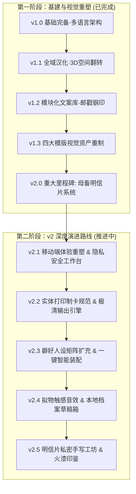

# 证件与协议工坊 (Proof & Indenture Studio) · 总体开发路线图 (Roadmap)

> **当前基线版本**：`v2.1` (模块化前端架构 · 五大高保真契约模版 · 移动端画中画实时预览 · 零泄露物理级隐私工坊 · 触控取景与情趣打码套件 · 4 语言 100% 词典平齐)  
> **更新时间**：2026-11-08 (v2.1 移动端体验重塑与零泄露隐私工作台已全面交付验收)  
> **核心目标**：从静态卡片排版系统，全面升级为**以移动端极致体验为基石、具备物理级实体制卡能力、兼具深度癖好人设与拟真触觉仪式感**的综合契约工坊。

---

## 阶段规划概览

---

## 历史达成里程碑（已完成）

<b>点击展开查看 v1.1 ~ v2.0 历史交付详情</b>

### 📌 v1.1 · 交互体验与细节精修版 (UX & 3D Immersion) · [已完成]
- [x] **任务 1：全域文本与汉化终极扫尾**：彻底清除未汉化残留，4 语言（`zh-CN`, `zh-TW`, `en`, `ja`）100% 词典平齐（265 keys），自动化测试通过。
- [x] **任务 2：模版 4（极清双面卡）纯 CSS 3D 拟真空间翻转交互**：纯 CSS 3D Transforms，翻转动效与侧栏联动，导出时防畸变平整化。

### 📌 v1.2 · 档案质感与模块灵感版 (Archive Textures & Inspiration) · [已完成]
- [x] **任务 3：侧栏“模块化誓言/批注灵感库”**：四大专属情境分类（忠犬、肉便器、反差、戒律），支持一键单点插入。
- [x] **任务 4：复古档案波浪邮戳与防伪钢印贴纸系统**：矢量同心圆波浪邮戳与 3D 立体浮雕凹凸钢印，支持自由位移、旋转与印泥色彩。

### 📌 v1.3 · 视觉资产重制与高清化 (Asset Remastering) · [已完成]
- [x] **任务 5：前四个模板图片素材重构与内置素材库扩充**：坐标网格纸底纹重绘、纯矢量 24K 晶体黑桃徽章、羊皮纸防伪五角星章、法医 macro 证物套件重制。

### 📌 v2.0 · 重磅里程碑：母畜明信片系统 (The Kinky Postcard Edition) · [已完成]
- [x] **任务 6：新增模版 5【母畜明信片 / Kinky Postcard】**：1011 × 638 px @ 300 PPI 黄金比例；正面支持写真拍立得与胶片滤镜；背面逼真明信片投递面（情话区、虚线、情趣邮票、寄件人与主人归属栏）；支持正反双面打包与 3D 翻转。

---

## 🚀 v2 下辖演进路线规划（规划与推进中）

根据 **GA4 真实流量数据（80% 移动端用户、模版 1 占据 52% 导出、3D 翻转高达 154 次、85% 用户误选 1X 标清）** 以及生如夏花论坛玩家核心痛点（“能做真人的吗？”、“打印出来更好”、“填表太长”），细化制定以下小版本规划：

---

### 📌 v2.1 · 移动端体验重塑与零泄露隐私工作台 (Mobile First & Zero-Leakage Privacy) · [已完成]

*核心诉求：化解 80% 移动端用户的输入与视线割裂痛点，消除真人自拍上传的顾虑与门槛。*

- [x] **任务 1：移动端自适应与“画中画”实时浮动预览 (Mobile PiP Live Preview)**
  - **画中画浮窗**：手机端在“编辑信息”页面下方或右下角增设半透明折叠微型卡片预览浮窗，改字时毫秒级同步渲染，无需在“编辑”与“预览”Tab 间来回横跳。
  - **软键盘防遮挡自适应**：虚拟键盘弹起时自动优化视口高度，锁死底部核心操作条，确保输入框不被遮挡、卡片画布无抖动错位。
  - **字段排版溢出即时预警**：在移动端输入框下方直接标注字符安全阈值（如“已输入 18/20 字，即将换行”），避免生成后才发现文本溢出。

- [x] **任务 2：真人自拍/私房照安全上传与局部隐私打码套件 (Privacy Avatar & Censorship Studio)**
  - **物理级零上传承诺提示**：在头像上传区显著标注 `📷 支持任意自拍/真人照片（100% 纯本地浏览器处理 · 绝不经过任何服务器 · 物理级隐私安全）`，解除论坛新用户疑虑。
  - **移动端触控裁剪手势**：支持移动端双指捏合缩放（Pinch-to-zoom）、单指拖拽平移、九宫格参考线与面部中心对齐辅助。
  - **情趣隐私遮挡套件**：提供一键贴覆可选遮挡贴纸（黑色绝密遮眼条 `CENSORED`、粉红心形眼罩、条形码封口贴、局部高斯模糊/马赛克），满足既想用真人照片又需要保护面部隐私的用户需求。

---

### 📌 v2.2 · 实体打印制卡规范与极清输出引擎 (Physical Print Studio & CR80 Bleed Line)

*核心诉求：解决 85% 用户误导出 1X 标清的盲区，全力赋能玩家将数字卡片转制为实体 PVC 收藏品。*

- [ ] **任务 3：重构导出工作流与 300 DPI 印刷级直达入口 (Smart Export Workflow)**
  - **双轨制显式导出按钮**：摒弃深层嵌套的下拉菜单，底部直接并列两颗醒目按钮：
    - `📱 保存手机相册 (1X 屏幕分享)`
    - `🖨️ 实体打印制卡 (2X 极清 300 DPI · 推荐)`
  - **智能导出弹窗 (Export Dialog)**：点击导出时弹出轻量级确认抽屉，提供格式选择（PNG 最佳质量 / JPG 小体积 / 打印单页），并智能提示当前模版已就绪的文件大小与分辨率。

- [ ] **任务 4：国际标准 PVC 卡 (CR80) 实体出片辅助线与对位裁切套件**
  - **工业级制卡出血线 (Bleed Lines)**：为模版 1、2、4 增设可选的“印刷辅助图层”：内置 2mm 国际制卡工业出血线、四角 R3.18 圆角裁切参考线、中心对齐十字标，导出的图片可直接交付淘宝或专业 PVC 卡片厂商印制磁条/光面卡。
  - **A4 纸拼版对折打印模式 (Fold-to-Print A4 Layout)**：针对模版 4 与模版 5 双面卡，提供一键生成一张标准 A4 尺寸的 PDF/PNG，正面与背面镜像并排，中缝带虚线折痕，普通玩家用家用打印机 + 6 寸相纸或 A4 卡纸打印后对折即可自制双面实体卡。

---

### 📌 v2.3 · 癖好人设矩阵扩充与全卡一键智能装配 (Persona Matrix & Smart One-Click Bundles)

*核心诉求：紧扣 GA4 数据中“温顺猫奴”与“反差人妻”断层领跑的偏好，解决模版 2 填写繁琐门槛。*

- [ ] **任务 5：高频受众定制人设包扩容 (Expanded Persona Preset Library)**
  - **🌸【反差人妻 / 堕落少妇】细化**：增设名门人妻、温婉教师、良家主妇在私密调教下的反差誓约、专属归属契约文案与相称证件照预设。
  - **🐾【狂热犬化 / 纯种母畜】细化**：增设专属项圈铭牌佩戴编号、四肢行走誓词、笼养作息表与专属服从守则。
  - **♠️【媚黑专宠 / 纯黑烙印】专属扩充**：专供模版 2 的极致沉沦人设（Queen of Spades 专属服从协议、黑桃刺青公证、专属黑人主人服从条款）。
  - **❄️【高岭之花 / 傲慢反转】**：高阶冷艳职场上司、法官/长官受调降阶档案。

- [ ] **任务 6：模版 2（身份证）18 项服从矩阵一键预设包 (Matrix Quick Bundles)**
  - 针对模版 2 底部 18 项复杂勾选框，在手机端增加一键装配方案：
    - 【初阶服从预设】（基础项圈、日常下跪、言语称呼）
    - 【反差羞耻预设】（户外露出、寸止控制、情趣装扮）
    - 【终极奴役预设】（肉体支配、不可逆印记、永久归属）
    - 【一键全选 / 一键清空】
  - 极大降低移动端小屏逐个点击 18 个微小复选框的输入疲劳感。

---

### 📌 v2.4 · 拟真拟物触感与档案多媒体交互 (Tactile Skeuomorphism & Audio-Haptic Rituals)

*核心诉求：引入物理世界拟真触觉与听觉反馈，强化契约缔结时的庄严、羞耻与沉浸感。*

- [ ] **任务 7：拟真仪式音效与触感震动反馈系统 (Tactile Sound & Haptic Feedback)**
  - **纯本地 Web Audio 合成音效**（体积 < 50KB 或纯合成音频，支持一键静音）：
    - 钢印盖压时的清脆机械金属反弹声（*Clack-Thud*）。
    - 档案波浪邮戳浸透印泥后盖在纸张上的沉闷压印声。
    - 3D 卡片翻面时的清脆空气切风声（*Whoosh*）。
    - 模版 5 明信片投递入邮筒的金属翻盖碰撞声。
  - **移动端触感反馈 (Web Vibration API)**：在手机浏览器支持下，盖章、切面、点击随机人设时触发轻微而细腻的短促马达震动，营造宛如真实按压印章的物理触感。

- [ ] **任务 8：绝密档案柜与本地 JSON 草稿箱 (Local Dossier Safe & JSON Backup)**
  - **纯本地多档案草稿箱**：利用浏览器 IndexedDB / localStorage，支持用户在本地保存多个不同人设（如“我的专属奴隶 01”、“少妇调教契约”），支持命名、切换与草稿自动保存，彻底避免误刷新丢失填写进度。
  - **配置导入/导出 (.slutid 文件)**：支持一键导出/导入单张卡片或全部档案配置为轻量 JSON 文件，方便论坛玩家互相分享“高质量人设卡模版”或跨设备迁移。

---

### 📌 v2.5 · 模版 5（明信片）进阶：私密手写字体库与火漆印鉴 (Postcard Atelier & Wax Seal)

*核心诉求：全面深化新上线的母畜明信片体验，强化私密信件投递的浪漫与堕落氛围。*

- [ ] **任务 9：多款拟真手写书法与复古打字机字体集成**
  - 精选轻量化 Web Fonts，提供明信片背面专属字体切换：
    - 🖋️ **娟秀少女手写体**（呈现真诚爱意、私密独白与羞耻告白）
    - 📜 **英式复古圆体花体**（呈现欧洲古典贵族契约与优雅调教风范）
    - 📠 **德式军用机械打字机体**（呈现绝密军事档案指令与冰冷规训感）
    - ✒️ **狂放毛笔行草体**（呈现强烈占有欲与烙印感）

- [ ] **任务 10：自定义情趣邮票工坊与 3D 浮雕火漆印鉴 (Wax Seal Overlay)**
  - **自定义邮票**：支持用户将自己或主人的专属小寸照一键套入复古锯齿邮票框内，自定义邮票面值与铭文（如 `MASTER ONLY 100¢`）。
  - **3D 拟真火漆印章 (Wax Seal Overlay)**：新增与波浪邮戳平行的火漆封蜡图层，支持复古暗红、黑金、幽紫、肉粉等多种蜡色，带有逼真的融蜡边缘与高光凹凸阴影，可自由拖动至明信片任意角落。

---

## 阶段验收与质量保障标准

| 检验维度 | 验收标准 | 验证手段 |
| :--- | :--- | :--- |
| **移动端首要原则** | 80% 用户场景严守单手可操作性，表单编辑与卡片预览在 375px~430px（iPhone SE / 13 / 15 Pro Max）屏幕下无横向滚动条、无键盘遮挡、无字号崩坏。 | BrowserOS neo 移动端真机仿真 + 软键盘弹起边界测试 |
| **尺寸与印刷规范** | 卡片标准尺寸严守 **1011 × 638 px @ 300 PPI (85.6mm × 54.0mm)**，模版 3 保持 A4/证书标准比例，2X 导出严守 300 DPI 无锯齿。 | Canvas 像素检测 + 打印对尺校验 |
| **自动化测试套件** | 每次提交必须通过 `node test_suite.js`（DOM ID 唯一性、事件委托完整性、4 语种 100% 字典平齐校验）。 | CI / 本地预检脚本 |
| **零泄露物理级隐私** | **100% 浏览器客户端渲染**。所有用户自拍、真人证件照、自定文字、本地草稿永不向任何外网服务器发包上传，断网离线状态下所有功能 100% 可用。 | 开发者工具 Network 面板断网与无网络发包抓包审计 |
