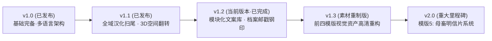

# 证件与协议工坊 (Proof & Indenture Studio) · 开发路线图 (Roadmap)

> **当前基线版本**：`v1.2` (模块化前端架构 · 四大高保真契约模版 · 4 语言 100% 词典平齐 · 模块化灵感语录库 · 复古波浪邮戳与3D防伪钢印)  
> **制定时间**：2026-11-01 (更新于 2026-11-02)  
> **核心目标**：从静态卡片排版系统，全面升级为兼具**深度癖好定制、拟真档案质感、3D 空间交互与明信片投递仪式感**的高级契约工坊。

---

## 阶段规划概览

---

## 详细版本演进路线

### 📌 v1.1 · 交互体验与细节精修版 (UX & 3D Immersion) · [已完成]

*聚焦基础体验的彻底完善与触觉交互维度的提升，解决视觉死角与翻转卡顿。*

- [x] **任务 1：全域文本与汉化终极扫尾 (Refined i18n & Localization)**
  - **范围排查**：排查并彻底修复模版 2“卡片字体风格”、模版 3“重新生成”、模版 4“卡片字体风格”及“主卡标题”等多处未汉化残留，修复多语言随机人设多模板轮换问题。
  - **词典同步**：确保所有新增与微调键在 `zh-CN`（简体中文）、`zh-TW`（繁體中文）、`en`（English）、`ja`（日本語）四语字典中 100% 对齐（265 keys），通过 `node test_suite.js` 严格校验。
  - **动态文案自适应**：各模板在极端文本长度与不同语言切换下平滑排版，无纯中文残留。

- [x] **任务 2：模版 4（极清双面卡）纯 CSS 3D 拟真空间翻转交互 (3D Card Flip Animation)**
  - **技术实现**：基于纯 CSS 3D Transforms（`perspective: 1600px`、`transform-style: preserve-3d`、`backface-visibility: hidden`），无需引入外部第三方依赖。
  - **拟真物理感**：翻转动画使用定制贝塞尔曲线（`cubic-bezier(0.4, 0, 0.2, 1)`），耗时 0.75s。
  - **双向联动与导出保护**：侧栏“正面/背面”标签切换与 3D 容器状态双向绑定，导出时强制平面化处理，保障 1011 × 638 px @ 300 PPI 极清无畸变输出。

---

### 📌 v1.2 · 档案质感与模块灵感版 (Archive Textures & Inspiration) · [已完成]

*解决用户定制文案“词穷”痛点，并极大强化证件的“官方特勤”、“归档机密”真实可信度。*

- [x] **任务 3：侧栏“模块化誓言/批注灵感库” (Modular Dedication & Vow Library)**
  - **功能设计**：为核心文案（性癖说明、服从誓言、底部标语、契约条款、评估定性、行为法则）旁增设独立的 **“💡 灵感库”** 弹窗。
  - **分类文案矩阵**：涵盖 🐶【绝对忠犬/专属从属】、💧【极度肉便器/完全开发】、👠【反差坠落/清冷长官】、⚖️【戒律惩诫/严格家法】四大专属情境分类，全语种 100% 本地化。
  - **非破坏性替换/追加**：支持“完全替换”与“追加末尾”两种模式，单点精准注入对应字段，自动保存草稿，无需重置全卡内容。

- [x] **任务 4：复古档案波浪邮戳与防伪钢印贴纸系统 (Postmark & Embossed Seal Overlay)**
  - **视觉呈现**：高精度纯矢量 SVG 动态渲染，支持无损 300 PPI 极清导出，提供双重经典制式：
    - **复古波浪盖销戳 (Cancellation Wave Postmark)**：同心圆机构戳（支持自定义机构名）+ 4 道做旧波浪盖销线 + 动态实时日期，支持印泥红、机密紫、档案蓝、碳素黑四色印泥。
    - **立体防伪钢印 (3D Embossed Notary Seal)**：36 齿精密放射太阳齿轮边框 + 双同心浮雕环 + 3D 高光/投影滤镜，呈现纸张凹凸立体压印质感。
  - **参数自由度**：支持“证件照角标”、“卡片右下角”、“卡片左下角”一键预设与 X/Y 位移、旋转角度（-45°~+45°）、不透明度滑块精确微调。

---

### 📌 v1.3 · 视觉资产重制与高清化 (Asset Remastering)

*重塑前四个模板的底图、默认证件寸照、装饰图元与徽章，消除任何低分辨率或杂边残留。*

- [ ] **任务 5：前四个模板图片素材重构与内置素材库扩充**
  - **模版 1 (奴隶身份卡)**：
    - 重绘/重新设计更高清晰度的坐标网格纸底纹与暗黑机密水印。
    - 提供两套全新默认头像：一套为项圈制服冷艳风，一套为黑条遮眼高反差风。
  - **模版 2 (媚黑身份证)**：
    - 彻底重构右上角黑金质感矢量装饰、黑桃 Q 徽章（消除边缘白边、升级为晶体金质纹理）。
    - 重新排布优化底部 18 项玩法服从列表的视觉微调排版。
  - **模版 3 (登记证书协议)**：
    - 升级双层复古欧洲羊皮纸底纹与边缘自然磨损噪点。
    - 重制专用章矢量 SVG 轮廓，支持更清晰的矢量印刷级导出。
  - **模版 4 (极清双面卡)**：
    - 重新制作两套正面高质量立绘与 EXH A（上围/项圈）、EXH B（腰腹/拘束）证物微距示意图。

---

### 📌 v2.0 · 重磅里程碑：母畜明信片系统 (The Kinky Postcard Edition)

*全新独立模版，彻底对标并超越 `bennadel/Kinky-eCards`，融合明信片浪漫私密感与主奴从属羁绊。*

- [ ] **任务 6：新增模版 5【母畜明信片 / Kinky Postcard】**
  - **版面与标准**：严格保持 **1011 × 638 px @ 300 PPI**（黄金比例），完美适配双面打印与合并长图。
  - **正面 (Front Side) · 视觉海报/写真面**：
    - 大幅主题写真/立绘展示，支持胶片暗角、拍立得白边、复古颗粒感滤镜切换。
    - 左上角微缩印有烫金邮戳标志与专属归属铭文。
  - **背面 (Back Side) · 拟真明信片投递面**：
    - **左侧私密情话区**：采用逼真的手写毛笔/钢笔手写字体，记录主奴寄语、调训指令或思念誓词。
    - **中部分隔线**：经典明信片竖向竖虚线分隔。
    - **右上角邮票区**：内置多款情趣专属邮票（如 `69¢ BDSM AIRMAIL`、`MASTER PROVED $1.00`、`PUPPY PET $0.50`），并叠印波浪取消邮戳。
    - **右下角收信人地址栏**：包含格式化横线：
      - *TO (收件犬/持卡人)*：姓名与佩戴编号。
      - *DELIVER TO (调教归属处)*：主人专属寝居 / 调训基地。
      - *FROM (寄件主人/签发官)*：主人大名与印鉴。
  - **专属导出与配套**：
    - 支持正面、背面独立导出、正反双面打包（Zip），以及与模版 4 一致的“正反合并长图全览”。
    - 完整接入 3D 翻转预览与 4 语言国际化系统。

---

## 阶段验收与质量保障标准

| 检验维度 | 验收标准 |
| :--- | :--- |
| **尺寸与印刷规范** | 卡片标准尺寸严守 **1011 × 638 px @ 300 PPI (85.6mm × 54.0mm)**，模版 3 保持 A4/证书标准比例。 |
| **自动化测试套件** | 每次提交必须通过 `node test_suite.js`（DOM ID 唯一性校验、事件委托完整性、4 语种 100% 对齐校验）。 |
| **视觉与跨端兼容** | 每次功能更新使用 BrowserOS neo 在桌面端与移动端尺寸下完成视觉回归审核，确保无遮挡、无溢出、无字体断裂。 |
| **纯本地与隐私第一** | 坚持 100% 浏览器客户端渲染，所有敏感图片、隐私档案、自定文字不经由任何第三方公网服务器上传。 |
